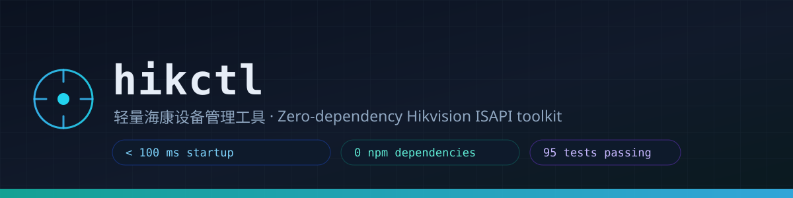
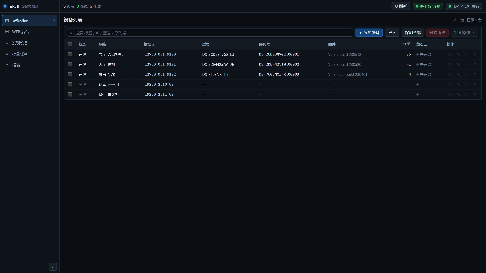
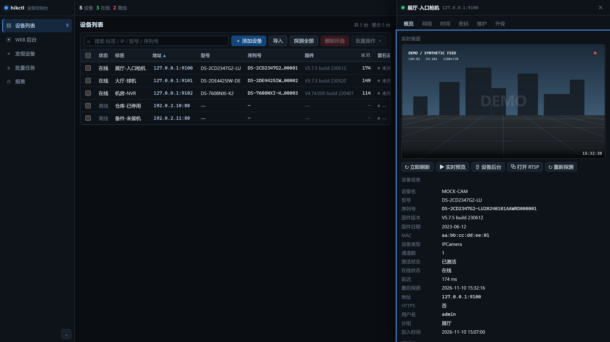
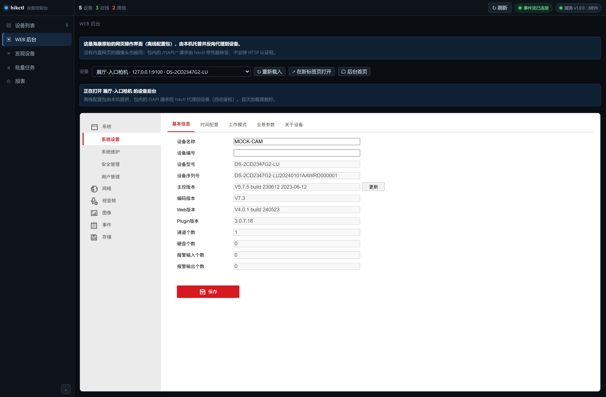
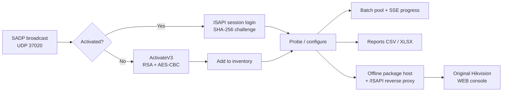
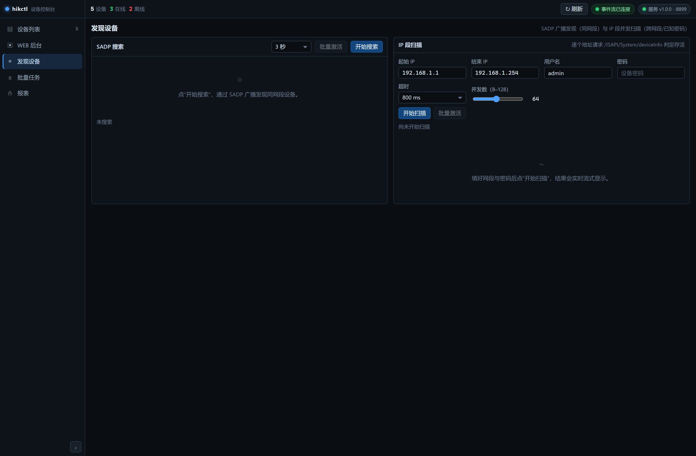
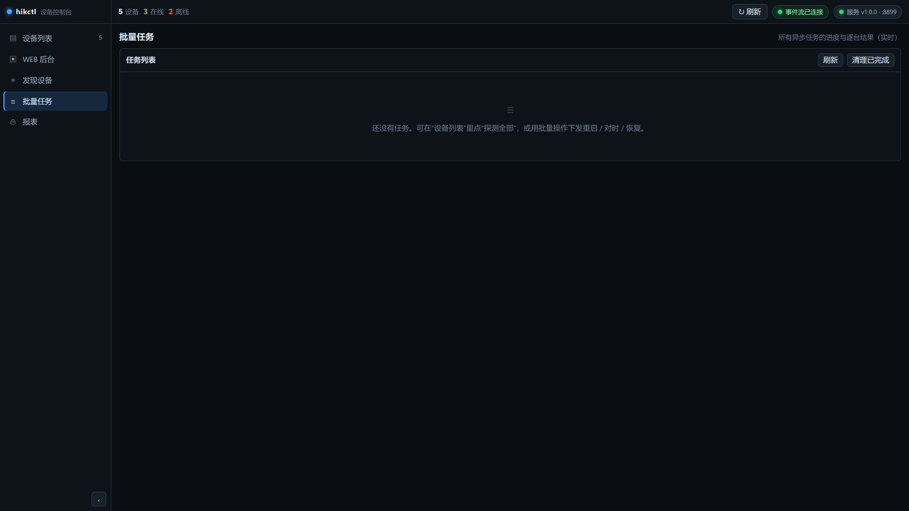
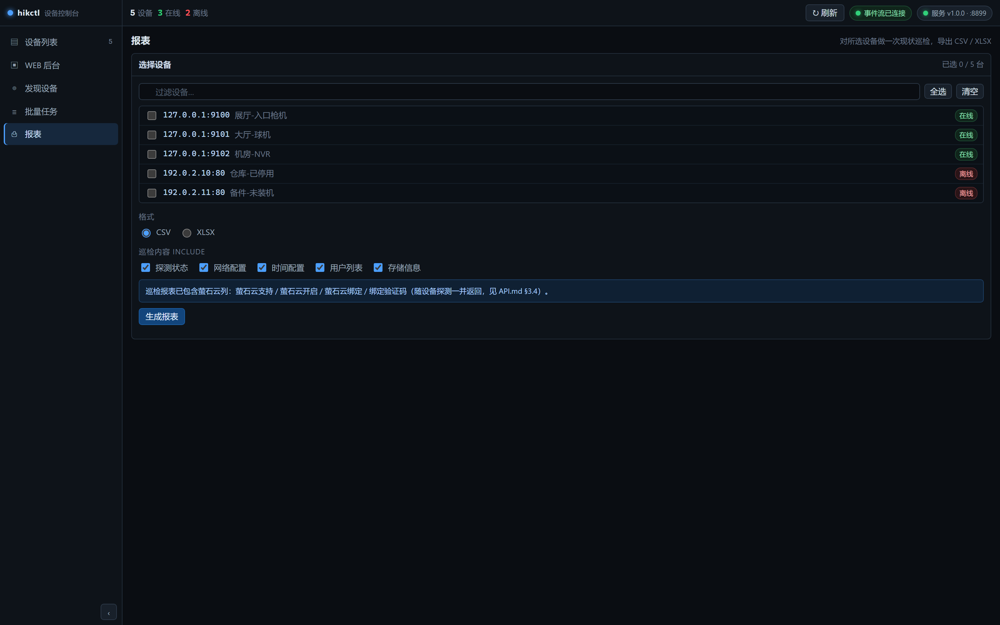
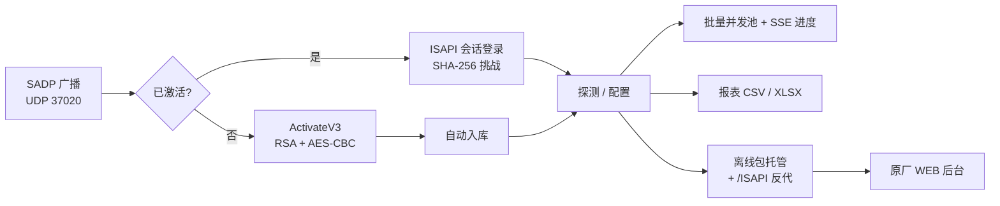

<p align="center">
  
</p>

<h1 align="center">hikctl</h1>

<p align="center">
  A zero-dependency, sub-100 ms Hikvision device console — activation, ISAPI configuration and a built-in WEB console for cameras that have no web UI at all.
</p>

<p align="center">
  <a href="LICENSE"></a>
  
  
  
  
</p>

> **Unofficial utility.** This project is not affiliated with, endorsed by, or
> supported by Hikvision. It speaks the device-local ISAPI protocol directly and
> is intended for technicians working on equipment they are authorized to
> service. Factory reset and network changes are **destructive** — read the
> warnings before using them.

## Overview

**hikctl** is a small local web application (a Node.js process plus a browser UI)
for people who have to provision and maintain fleets of Hikvision cameras, NVRs
and access controllers on a LAN. It replaces the heavy vendor tool chain with
one process that starts in well under 150 ms and talks the same protocol the
devices already speak.

Three things make it different from a generic ISAPI wrapper:

1. **It can activate brand-new devices.** Activation uses the same
   `ActivateV3` challenge-response the vendor tool uses (RSA-wrapped AES key,
   AES-CBC encrypted password), so an unactivated camera can be brought online
   without any vendor software.
2. **It gives cameras a web UI they don't have.** Many Hikvision models ship
   without an embedded HTTP front-end (`/index.asp` returns `404`). hikctl hosts
   a Hikvision **offline configuration package** locally and reverse-proxies the
   package's `/ISAPI/*` calls back to the device — so the *original* web console
   opens, configured, for a camera that has no web console of its own.
3. **It is fast on purpose.** A probe is one or two HTTP round trips (5–50 ms on
   a LAN). Batch operations run through a bounded concurrency pool with live
   progress over SSE, so 50 devices take about as long as the slowest one.



## Features

**Discovery**

- SADP discovery over UDP 37020 (finds devices that have no IP or are on another
  subnet) plus a concurrent IP-range scan over ISAPI.
- Unactivated devices are reported as unactivated rather than "offline": the SADP
  reply and `/SDK/activateStatus` are checked before any authenticated call.
- Broadens to a directed broadcast using the interface netmask, so `/22` and
  wider subnets are covered.

**Activation**

- Batch activation with a configurable default password (validated against the
  device's own password policy: 8–16 chars, at least two character classes).
- Activation status is tri-state (`activated` / `not activated` / `unknown`) so a
  transient network failure never leaves a device permanently labelled "not
  activated".
- After activation the device is auto-added to the inventory and re-probed with
  retries, because a freshly activated unit takes a moment to expose ISAPI.

**Configuration (ISAPI)**

- Device identity, firmware, MAC, channel count.
- Network: IP, mask, gateway, DNS, DHCP — with a pre-flight check that the new
  address is actually reachable before reporting success.
- Time: manual or NTP.
- Password change.
- EZVIZ / 萤石云 status: supported, enabled, bound, bind status and verification
  code requirement (read from `registerStatus`, not the capability flag).
- Raw ISAPI passthrough for anything not wrapped by the UI (the API surface is
  catalogued in [`API.md`](API.md) — 812 endpoints extracted from the vendor
  packages).

**Maintenance**

- Reboot, **simple reset** (`mode=basic`) and **full factory reset**
  (`mode=full`) — one confirmation dialog each, no multi-step gates.
- Firmware upgrade with progress.
- Reports: CSV and XLSX, generated in-process (the XLSX writer is hand-rolled on
  top of `zlib`, so there is still no dependency).

**Live view**

- MJPEG relay, or snapshot polling when the device refuses MJPEG.
- RTSP URL with credentials, ready for VLC / ffmpeg.

**The built-in WEB console** — see below.



## The built-in WEB console

This is the feature that motivated the project. A camera with no embedded web
server normally cannot be configured from a browser at all.

hikctl solves it the same way the vendor tool does, but without nginx, Redis or
the vendor SDK:

| Piece | What hikctl does |
| --- | --- |
| Static host | Serves the Hikvision **offline configuration package** (`ConfigKitSDK.js` + `Packages/<sign>/webs_<ver>_isapi/...`) from a local port (default `9099`). |
| Bootstrap | `GET /open?device=<ip:port>` sets the `ProxyHostInfo` / `SDKMode` cookies and calls `ConfigKit.Init()` exactly like the vendor page does. |
| Reverse proxy | `GET /DISPATCH_ip_<host>/<path>` and `GET /ISAPI/*` are forwarded to the real device **with hikctl's own credentials**, so the browser never sees an HTTP auth prompt and HTTPS-only devices are terminated locally. |

The console is available three ways: the **WEB 后台** item in the sidebar (the
original Hikvision UI, embedded), a **🖥 设备后台** button in the device drawer, or
by opening the console port directly.



> The offline package is **not** redistributed here. hikctl reuses whatever copy
> of HiToolsDelivery is already installed on the machine
> (`…\userData\plugins\base\nginx\html\WebConfigCtrl`, ~489 MB, 24 packages) or
> any directory you point `--packages` at. Without one, the rest of the tool
> still works; only the WEB console entry is unavailable.

## How it works



Authentication is the interesting part. New firmware exposes
`POST /ISAPI/Security/sessionLogin` with a SHA-256 challenge-response; the
password is never sent. The response does **not** echo a session id — the cookie
is `WebSession_<8 hex>` and must be captured verbatim from `Set-Cookie`. Old
firmware only supports HTTP Digest, so hikctl verifies the session actually works
and falls back to Digest when it does not. Credentials are stored with
AES-256-GCM at rest.

## Requirements

- **Node.js 20 or newer** (developed and tested on v24). That is the only
  requirement — there is no `npm install` and no network access is needed.
- Windows 10/11, Linux or macOS. The browser UI is served on `127.0.0.1`.
- Network reachability to the devices you manage (same LAN, or routed).
- For the WEB console: an existing copy of the Hikvision offline package, or a
  directory with one (`--packages`).

## Installation

```bash
git clone https://github.com/szrd2026/hikctl.git
cd hikctl
```

There is nothing to build and nothing to install.

### Windows one-click

Two shortcuts are provided (or create them yourself with
`tools/start.ps1` / `tools/stop.ps1`):

| Shortcut | Action |
| --- | --- |
| **hikctl 启动** (`hikctl-start.cmd`) | Starts the service in the background and opens the browser. If it is already running, it just opens the UI. |
| **hikctl 关闭** (`hikctl-stop.cmd`) | Gracefully stops it via `POST /api/shutdown`, with a PID fallback. |

### From the command line

```bash
node src/main.js                 # default port 8787, opens the browser
node src/main.js --port 9000     # different port (auto-increments if busy)
node src/main.js --no-open       # don't open a browser
node src/main.js --no-console    # don't start the WEB console host
node src/main.js --data <dir>    # use a separate device inventory
node src/main.js --help
```

## Usage

1. Start the app and open `http://127.0.0.1:8787/`.
2. Go to **发现设备** and run an SADP search (same subnet) or an IP-range scan.
3. Unactivated devices are marked as such. Select them and **批量激活** — set the
   default password once, click activate, done.
4. The device is added to **设备列表** automatically. Open a device to configure
   network, time, password, or to reboot / reset / upgrade.
5. To use the original Hikvision UI, click **WEB 后台**.







### Demo mode (no hardware)

Two mock cameras and two unreachable devices are generated for you, so the UI can
be explored and the screenshots reproduced:

```bash
node tools/demo.mjs                 # starts mock devices on 127.0.0.1:9100-9102
node src/main.js --data ./demo-data --port 8899 --console-port 9199 --no-open
```

All addresses in the demo are synthetic: `127.0.0.1:91xx` for reachable mocks and
`192.0.2.10` / `192.0.2.11` (RFC 5737 TEST-NET-1) for the offline ones.

## Configuration

Everything is a CLI flag; there is no config file.

| Flag | Default | Meaning |
| --- | --- | --- |
| `--port`, `-p` | `8787` | Main HTTP port. If busy, it increments. |
| `--host` | `127.0.0.1` | Bind address. Keep it on loopback unless you know why. |
| `--console-port` | `9099` | Port for the offline-package host. |
| `--packages <dir>` | auto-detect | Offline configuration package root. |
| `--data <dir>` | `./data` | Device inventory directory. |
| `--no-console` | off | Skip the WEB console host. |
| `--no-open` | off | Don't launch a browser. |

Runtime files: `data/devices.json` (AES-256-GCM sealed passwords),
`data/runtime.json` (`pid` / `port` used by the stop shortcut), `reports/`.
All three are git-ignored.

## Project layout

```text
src/            server, ISAPI client, activation, console proxy, reports
  server.js     HTTP API + SSE
  client.js     ISAPI client: session + digest auth, retries
  activate.js   ActivateV3 (RSA/AES) and password policy
  ops.js        probe, network, time, reboot, reset, upgrade, EZVIZ
  console.js    offline-package host + reverse proxy
  sadp.js       UDP 37020 discovery
web/            the browser UI (vanilla ES modules, no framework)
test/           mock device + 95 integration tests
tools/          demo, screenshots (CDP), diagnostics, static checks
docs/           banner and screenshots
API.md          HTTP API contract and the ISAPI endpoints used
```

## Tests

```bash
node test/run.js          # 95 tests: unit + end-to-end against a mock device
node tools/uitest.mjs     # executes web/app.js in Node with a DOM shim
node tools/staticcheck.mjs web
```

`test/run.js` spins up a mock camera that speaks session auth, Digest, activation
and EZVIZ, then exercises the real HTTP API end to end.

`tools/uitest.mjs` is worth calling out: it boots the actual front-end in Node
against a minimal DOM shim. It catches a class of bug `node --check` cannot see —
for example a stray `async` token, which is *valid syntax* but throws
`ReferenceError` at module evaluation and leaves the page rendered but completely
unresponsive.

## Security and privacy

- No telemetry, no analytics, no auto-update, no outbound connections. Every
  request goes to `127.0.0.1` or to a device you named.
- Device passwords are sealed with AES-256-GCM; the key lives outside the JSON
  file. They are still recoverable by anyone who can run code as you — treat the
  machine accordingly.
- `POST /api/shutdown` is restricted to loopback callers, so exposing the UI on a
  LAN does not let others stop it.
- The HTTP API has **no authentication of its own**. It binds to `127.0.0.1` by
  default for that reason. Do not put it on a public interface.
- Logs and reports contain device serial numbers and MAC addresses. Treat them as
  business-confidential.
- Never commit `data/`, `demo-data/`, `reports/` or any `*.local.json`.

## FAQ

### The WEB console shows "未找到离线配置包目录"

hikctl could not find a Hikvision offline package. Install/maintain
HiToolsDelivery, or point `--packages` at a `WebConfigCtrl` directory that
contains `ConfigKitSDK.js`. The rest of the tool keeps working.

### A device is shown as "未激活" but I know it is activated

That state is only reported on positive evidence. If the device is unreachable or
the password is wrong you will see "未知" plus the underlying error instead. Use
**重新探测** to refresh.

### Activation fails with `badParameters` / `Invalid JSON Content`

The `ActivateV3` payload must use `base64(hex(modulus))` for the public key and
`base64(hex(ciphertext))` for the challenge. The vendor error message does not
say this. See [`API.md`](API.md) for the exact encoding.

### MJPEG preview stays black

Many models answer `503 deviceBusy` on channel 101. Channel 102 usually works;
hikctl falls back to snapshot polling automatically. `X-Preview-Mode` in the
response tells you which path was used.

### The page loads but nothing is clickable

That was a real bug class here (a runtime error during boot). Run
`node tools/uitest.mjs` — it will tell you which view fails and why.

### Does it work with NVRs and access controllers?

Discovery, ISAPI probing and the WEB console work with anything that speaks
ISAPI. The maintenance operations are camera-oriented; an NVR may reject some of
them, in which case you get the device's own error code.

## License

Released under the [MIT License](LICENSE). Copyright (c) 2026 szrd2026.

---

## 中文说明

**hikctl** 是一个**零依赖、启动不到 150 毫秒**的局域网海康设备管理工具：激活新设备、通过 ISAPI 配置参数，并给**本来没有网页的摄像头**补上一个原汁原味的 WEB 后台。

> **非官方工具。** 本项目与海康威视无隶属、背书或支持关系。只用于你**有权维护**
> 的设备。恢复出厂设置、修改 IP 属于**破坏性操作**，请先看懂警告再用。

### 概述

很多现场要面对几十上百台海康摄像机、NVR 和门禁。海康原厂工具功能全，但体系重、启动慢。hikctl 把这件事收敛成**一个进程 + 一个浏览器页面**：

1. **能激活全新设备。** 用与海康工具相同的 `ActivateV3` 挑战-应答（RSA 包裹 AES 密钥，AES-CBC 加密密码），不装任何原厂软件就能把未激活设备上线。
2. **能给没有网页的摄像头补上网页。** 不少机型没有内置 HTTP 前端（`/index.asp` 返回 `404`）。hikctl 在本机托管海康的**离线配置包**，并把包内发出的 `/ISAPI/*` 请求反向代理回设备 —— 于是**原始的海康网页界面**真的能打开、能用。
3. **是刻意做快的。** 一次探测就是一两次 HTTP 往返（局域网 5–50 ms）。批量操作走有界并发池，进度通过 SSE 实时推送，50 台设备的总耗时约等于最慢的那一台。


### 主要功能

**发现**

- SADP 广播发现（UDP 37020），能发现没配 IP、或不在同网段的设备；另有并发 IP 段扫描。
- **未激活的设备会如实标注为「未激活」**，而不是笼统的「离线」：先看 SADP 应答和 `/SDK/activateStatus`，再决定是否发鉴权请求。
- 按网卡掩码计算定向广播地址，`/22` 这类大网段也能覆盖。

**激活**

- 批量激活，默认密码可配置（按设备自身的密码策略校验：8–16 位、至少两类字符）。
- 激活状态是**三态**（已激活 / 未激活 / 未知），一次瞬时网络故障不会把设备永久错标成「未激活」。
- 激活后自动入库，并带重试地重新探测 —— 刚激活的设备需要一点时间才把 ISAPI 栈拉起来。

**配置（ISAPI）**

- 设备身份、固件、MAC、通道数。
- 网络：IP、掩码、网关、DNS、DHCP；改完会**先确认新地址真的能连上**才报成功。
- 时间：手动或 NTP。
- 修改密码。
- 萤石云状态：是否支持、是否开启、是否绑定、绑定状态、验证码要求（读的是 `registerStatus`，不是能力位）。
- 任意 ISAPI 透传，界面没封装的参数也能改（接口清单见 [`API.md`](API.md)，共 812 个端点）。

**维护**

- 重启、**简单恢复**（`mode=basic`）、**完全恢复**（`mode=full`）—— 每个只弹一次确认框，没有多道门槛。
- 固件升级（带进度）。
- 报表：CSV 与 XLSX，进程内生成（XLSX 写入器是基于 `zlib` 手写的，所以依然没有依赖）。

**实时画面**

- MJPEG 转发；设备不支持 MJPEG 时自动降级为抓图轮询。
- 带凭据的 RTSP 地址，可直接丢给 VLC / ffmpeg。

**内置 WEB 后台** —— 见下一节。


### 内置 WEB 后台（重点）

这就是本项目存在的原因。没有内置网页服务的摄像头，正常情况根本没法从浏览器配置。

hikctl 的做法和海康交付助手一致，但**不需要 nginx、Redis 和海康 SDK**：

| 组成 | hikctl 的做法 |
| --- | --- |
| 静态托管 | 在本机端口（默认 `9099`）托管海康**离线配置包**（`ConfigKitSDK.js` 与 `Packages/<sign>/webs_<ver>_isapi/...`）。 |
| 引导页 | `GET /open?device=<ip:port>` 下发 `ProxyHostInfo` / `SDKMode` Cookie，并调用 `ConfigKit.Init()`，与原厂页面一致。 |
| 反向代理 | `GET /DISPATCH_ip_<host>/<path>` 与 `GET /ISAPI/*` 转发到真实设备，**自动带上 hikctl 保存的凭据**，所以浏览器不会弹 HTTP 认证框；HTTPS 设备也在本地终结。 |

三个入口都能进：左侧导航 **「WEB 后台」**（内嵌原厂界面）、设备详情里的 **🖥 设备后台** 按钮、或直接打开后台端口。


> **本项目不再分发离线配置包。** hikctl 复用本机已安装的 HiToolsDelivery
> （`…\userData\plugins\base\nginx\html\WebConfigCtrl`，约 489 MB / 24 个包），
> 或用 `--packages` 指向你自己的副本。找不到时其余功能照常可用，只是「WEB 后台」不可用。

### 工作原理



鉴权部分是关键：新固件提供 `POST /ISAPI/Security/sessionLogin` 做 SHA-256 挑战-应答，密码不落网；但**响应里不回显 session id**，Cookie 名是 `WebSession_<8位十六进制>`，必须原样从 `Set-Cookie` 取。老固件只支持 HTTP Digest。因此 hikctl 会**先验证会话真的可用**，不可用再回落到 Digest。密码在磁盘上用 AES-256-GCM 加密。

### 运行要求

- **Node.js 20 或更高**（开发测试于 v24）。这是唯一的依赖 —— 不需要 `npm install`，也不需要联网。
- Windows 10/11、Linux 或 macOS。界面只监听 `127.0.0.1`。
- 能访问你要管理的设备（同网段或可达）。
- 要用 WEB 后台：本机需有海康离线配置包，或用 `--packages` 指定目录。

### 安装

```bash
git clone https://github.com/szrd2026/hikctl.git
cd hikctl
```

无需构建，无需安装。

**Windows 一键启动**：提供两个快捷方式（也可用 `tools/start.ps1` / `tools/stop.ps1` 自行创建）：

| 快捷方式 | 作用 |
| --- | --- |
| **hikctl 启动**（`hikctl-start.cmd`） | 后台启动服务并打开浏览器；已在运行则直接打开界面 |
| **hikctl 关闭**（`hikctl-stop.cmd`） | 通过 `POST /api/shutdown` 优雅停止，失败再按 PID 兜底 |

**命令行**：

```bash
node src/main.js                 # 默认 8787，自动开浏览器
node src/main.js --port 9000     # 换端口（被占用会自动 +1）
node src/main.js --no-open       # 不开浏览器
node src/main.js --no-console    # 不启动 WEB 后台托管
node src/main.js --data <目录>   # 使用另一套设备库
node src/main.js --help
```

### 使用流程

1. 启动后打开 `http://127.0.0.1:8787/`。
2. 进入「发现设备」，用 SADP 搜索（同网段）或 IP 段扫描（跨网段/已知密码）。
3. 未激活设备会被标出来。勾选后点「批量激活」—— 设一次默认密码，点激活即可。
4. 设备会自动进入「设备列表」。点开可配置网络、时间、密码，或重启 / 恢复 / 升级。
5. 想看原厂界面就点「WEB 后台」。


**演示模式（无需真机）**：内置两台模拟摄像头和两台不可达设备，方便体验和复现文档截图。

```bash
node tools/demo.mjs                 # 在 127.0.0.1:9100-9102 起模拟设备
node src/main.js --data ./demo-data --port 8899 --console-port 9199 --no-open
```

演示里的地址全部是合成的：可达的用 `127.0.0.1:91xx`，离线的用 `192.0.2.10` / `192.0.2.11`（RFC 5737 TEST-NET-1，保留给文档示例，永远不可能是真实设备）。

### 配置项

全部通过命令行参数，没有配置文件。

| 参数 | 默认值 | 说明 |
| --- | --- | --- |
| `--port`, `-p` | `8787` | 主服务端口；被占用则自动 +1 |
| `--host` | `127.0.0.1` | 监听地址，除非有明确理由，否则保持回环 |
| `--console-port` | `9099` | 离线配置包托管端口 |
| `--packages <目录>` | 自动查找 | 离线配置包根目录 |
| `--data <目录>` | `./data` | 设备库目录 |
| `--no-console` | 关闭 | 不启动 WEB 后台托管 |
| `--no-open` | 关闭 | 不自动打开浏览器 |

运行期文件：`data/devices.json`（密码 AES-256-GCM 加密）、`data/runtime.json`（「关闭」快捷方式靠它找进程）、`reports/`。三者都已加入 `.gitignore`。

### 项目结构

```text
src/            服务端、ISAPI 客户端、激活、后台代理、报表
  server.js     HTTP API + SSE
  client.js     ISAPI 客户端：会话 + Digest 鉴权、重试
  activate.js   ActivateV3（RSA/AES）与密码策略
  ops.js        探测、网络、时间、重启、恢复、升级、萤石云
  console.js    离线包托管 + 反向代理
  sadp.js       UDP 37020 发现
web/            浏览器界面（原生 ES 模块，无框架）
test/           模拟设备 + 95 项集成测试
tools/          演示、截图（CDP）、诊断、静态检查
docs/           横幅与截图
API.md          HTTP 接口契约与被使用的 ISAPI 端点
```

### 测试

```bash
node test/run.js          # 95 项：单元 + 对着模拟设备跑完整流程
node tools/uitest.mjs     # 在 Node 里用 DOM 模拟真实执行 web/app.js
node tools/staticcheck.mjs web
```

`test/run.js` 会起一台会说话（会话鉴权、Digest、激活、萤石云）的模拟摄像头，然后走真实 HTTP 接口做端到端验证。

特别说明 `tools/uitest.mjs`：它在 Node 里用最小 DOM 模拟**真实启动前端**，能抓到 `node --check` 抓不到的一类 bug —— 例如一个游离的 `async` 关键字，**语法合法**，但求值阶段就 `ReferenceError`，结果是页面渲染出来了却完全点不动。

### 安全与隐私

- 没有遥测、没有统计、没有自动更新、不连外网。所有请求只发往 `127.0.0.1` 或你指定的设备。
- 设备密码用 AES-256-GCM 加密，密钥不放在 JSON 里。但**能以你的身份运行代码的人仍然可以还原**，请按此标准保护这台机器。
- `POST /api/shutdown` 只接受回环地址调用，所以即使把界面暴露到局域网，别人也关不掉它。
- HTTP API **自身没有鉴权**，因此默认只监听 `127.0.0.1`。不要把它放到公网接口上。
- 日志与报表含设备序列号、MAC 地址，请按业务敏感数据保管。
- 绝对不要提交 `data/`、`demo-data/`、`reports/` 或任何 `*.local.json`。

### 常见问题

**「未找到离线配置包目录」**
没找到海康离线配置包。安装/保留 HiToolsDelivery，或用 `--packages` 指向含 `ConfigKitSDK.js` 的 `WebConfigCtrl` 目录。其余功能不受影响。

**设备明明是激活的，却显示「未激活」**
该状态只在**有明确证据**时才报。设备不可达或密码错误会显示「未知」并给出具体错误。点「重新探测」刷新。

**激活报 `badParameters` / `Invalid JSON Content`**
`ActivateV3` 的载荷必须用 `base64(hex(modulus))` 传公钥、`base64(hex(ciphertext))` 传挑战值 —— 原厂错误信息不会告诉你这一点。具体编码见 [`API.md`](API.md)。

**MJPEG 预览一直黑屏**
不少机型对通道 101 返回 `503 deviceBusy`，换 102 通常就好；hikctl 也会自动降级为抓图轮询。响应头 `X-Preview-Mode` 会告诉你是走了哪条路。

**页面能打开，但点什么都没反应**
本项目确实踩过这类坑（启动期运行时异常）。跑一次 `node tools/uitest.mjs`，它会告诉你是哪个视图、什么原因。

**支持 NVR 和门禁吗？**
只要设备说 ISAPI，发现、探测和 WEB 后台都可用。维护类操作偏摄像机；NVR 可能拒绝其中一部分，此时会返回设备自己的错误码。

### 许可

本项目采用 [MIT License](LICENSE)，版权归属 szrd2026（2026）。